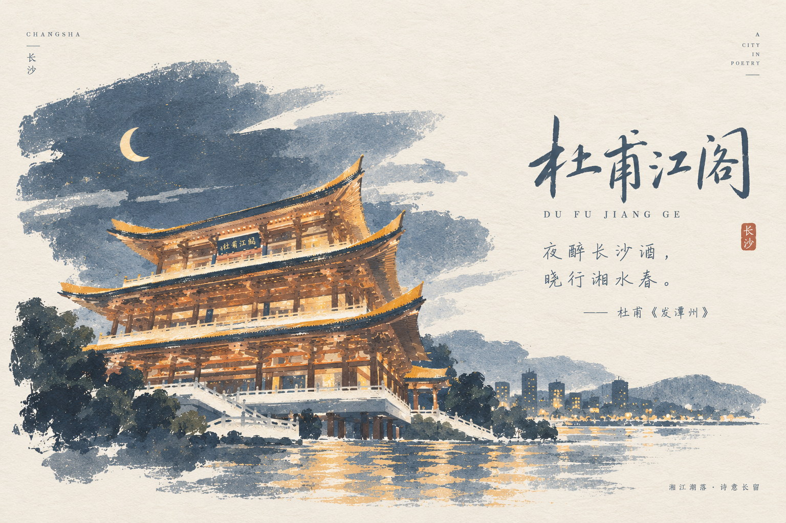

# Photo to Zine Postcard

**中文** · [English](README_EN.md)

把你拍摄的旅行 / 地标照片，转换成一张「诗意城市」风格的水彩明信片：照片主体重绘为水墨淡彩插画，配上书法地名、一句古诗和一枚小印章。



这个仓库提供一份可直接复用、**不绑定特定平台**的 [`SKILL.md`](SKILL.md)，可以指导 ChatGPT、Gemini、Claude.ai，或是 Claude Code 这类 agentic 工具，将一张照片生成一套统一的明信片正反面：

- **正面** — 横版 `3:2`。左侧把照片主体忠实重绘为水墨淡彩插画，边缘以枯笔晕散融入纸面；右侧是大号书法地名、拼音副标题、朱红小印、两句古诗及出处；四角配极简小字。
- **背面** — 同一纸张与线条语言的可书写明信片背面，包括邮票区、分割线、地址线和留言区域。

## 快速开始

### 方式一：直接在聊天里生成（ChatGPT / Gemini / Claude.ai 等支持生图的助手）

1. 把这个仓库提供给助手，或者直接上传 [`SKILL.md`](SKILL.md)。
2. 上传一张你拍摄的照片，最好附上地名和城市（例如"杜甫江阁，长沙"）。
3. 输入：

```text
请读取这个仓库里的 SKILL.md，并把它作为唯一的设计规范。
把我上传的照片生成一套 Photo to Zine Postcard 明信片正反面。地点：杜甫江阁，长沙。
```

如果你有想用的诗句，也可以一并给出；否则助手会选一句与该地相关的真实古诗，并核对原文与出处，没把握时会问你或者不放诗句。

### 方式二：在 Claude Code 或其他 agent 中调用

Claude Code 等编码 agent 通常不能自己画图，但可以把 `SKILL.md` 当作规范来编排生成流程：

- 如果你配置了可调用的生图工具/API（比如 MCP 图片生成工具，或脚本化调用的图片生成接口），告诉 agent：

  ```text
  读取这个仓库里的 SKILL.md 作为设计规范，用这张照片按照它的 Front/Back Prompt Template 调用图片生成工具，生成明信片正反面并保存到本地。
  ```

- 如果没有可用的生图工具，agent 会直接把填好的 Front/Back Prompt 文本输出给你，你再把这段文本连同照片粘贴到任意支持生图的助手里即可。

无论哪种方式，agent 都应先亲自看一遍照片，填写 `SKILL.md` 第 14 节的 Photo Analysis（主体、拍摄角度、匾额文字、配色），再套用模板。更完整的多平台调用说明见 `SKILL.md` 第 3 节 "Supported Agents & Invocation"。

## 设计原则

1. **忠实于原照**：重绘的是照片里真实的主体，轮廓、层数、屋檐、匾额位置、拍摄角度和光线氛围都要对得上；匾额文字要么一字不差、顺序正确，要么留白，绝不画成乱码。
2. **水墨淡彩，留出纸面**：插画以枯笔晕边融入宣纸色背景，不加矩形边框。
3. **地名与诗句都是真的**：不编造地名；古诗必须原文准确、作者篇名无误，没把握就不放。
4. **克制的版式**：一个书法标题、一枚印章、两句诗、四角小字，不再加别的模块。
5. **色彩取自照片**：通常是一个主光色（如灯火金）、一个氛围色（如靛蓝）和一个暗部色。

## 默认输出

- 横版 `3:2`
- 参考成品尺寸：`150 × 100 mm / 6 × 4 in`
- 暖白宣纸 / 水彩纸纹理
- 左侧水墨淡彩重绘主体，右侧书法标题 + 古诗
- 一枚朱红小印
- 一张统一、可书写的明信片背面
- 以模型支持的最大 3:2 尺寸生成（如 `1536 × 1024`），打印前放大到至少 `1800 × 1200 px`，推荐 4× 超分辨率

## 官方案例

**长沙 · 杜甫江阁**

| 原照 | 明信片正面 | 明信片背面 |
|---|---|---|
|  |  |  |

诗句：夜醉长沙酒，晓行湘水春。—— 杜甫《发潭州》

标语「湘江潮落 · 诗意长留」为原创短句，非引文。生成所用的完整提示词见 [`examples/changsha-dufu-jiangge-prompts.md`](examples/changsha-dufu-jiangge-prompts.md)。

## 如何定制自己的版本

你可以修改插画风格、纸张、字体、比例、角标文字、背面设计等。改动时一次只改一个维度，保持"左画右字、留出纸面、一印两句诗"的结构最稳定；如果改动较大，更推荐创建独立 variant，而不是不断给默认 Skill 增加规则。

## 仓库结构

```text
photo-to-zine-postcard/
├── SKILL.md
├── README.md
├── README_EN.md
├── LICENSE
├── examples/
│   └── changsha-dufu-jiangge-prompts.md
└── assets/
    ├── changsha-dufu-jiangge-photo.jpg
    ├── changsha-dufu-jiangge-front.png
    └── changsha-dufu-jiangge-back.png
```

## 当前版本

**v1.1.0**
- 新增 Photo Analysis 步骤，生成前先看图记录角度、匾额文字和配色
- 要求保持原照拍摄角度；匾额文字必须准确且保持阅读方向，否则留白
- 分辨率改为"最大原生尺寸生成 + 放大"，与主流生图模型一致
- 模板去掉写死的内容，补充非中文地点的标题、印章和署名规则
- 明确标语可原创但不得伪装成引文；新增背面示例与示例提示词文件

**v1.0.0**：首个公开版本。

## 参与贡献

欢迎提交 PR、贡献新的案例或衍生风格。案例请附上原照和成品，并确保你有权公开这些照片。

## License

MIT License，详见 [`LICENSE`](LICENSE)。
